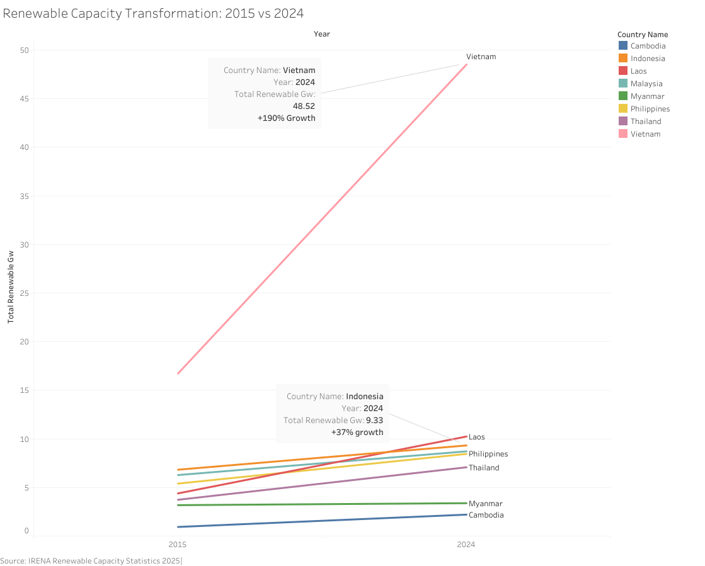
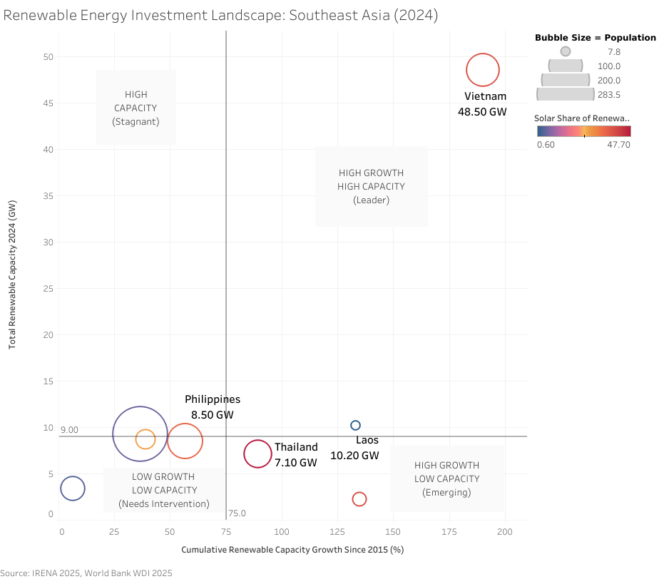
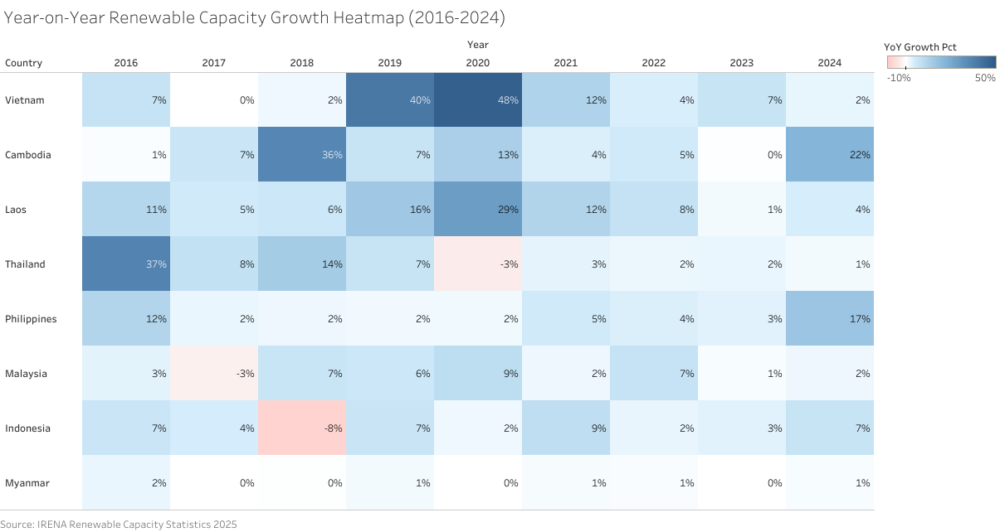

# Renewable Energy Capacity in Southeast Asia (2015–2024)

Individual data slice for an SDG 7 group project. It tracks installed on-grid renewable
capacity in eight ASEAN countries and links it to World Bank population and electricity
indicators.



## Run it

```bash
python scripts/run_pipeline.py --check
```

This creates `output/sdg7_renewable.db`, runs the four SQL scripts in order, prints every
validation check (✓/✗), exports the clean tables to `output/` and compares them with
`data/processed/`.

To run the same steps manually in the sqlite3 CLI, see the header of `sql/01_create_tables.sql`.

## Pipeline

| Step | Script | What it does |
|---|---|---|
| 1 | `sql/01_create_tables.sql` | `country_lookup` dimension (ISO-3 codes, name variants per source), staging and analysis tables with CHECK, UNIQUE and FK constraints |
| 2 | `sql/02_data_cleaning.sql` | Filters IRENA to on-grid installed MW, groups 6 technologies into Solar/Wind/Hydro/Other, unpivots World Bank years, applies missing-value rules, validates row counts |
| 3 | `sql/03_analysis_queries.sql` | Country-year totals and technology shares, YoY and cumulative growth (three-way self-join), rankings with window functions |
| 4 | `sql/04_bridge_query.sql` | Joins capacity with population and electricity access (MW per million people, investment signal), plus the planned integration view for the team project |

**Missing-value rule.** IRENA `-` means the technology is not deployed, so it becomes `0`.
World Bank `..` means the figure is not reported yet, so it becomes `NULL`.

## Outputs

| File | Rows | Grain |
|---|---|---|
| `renewable_capacity_clean.csv` | 480 | country × year × technology |
| `renewable_summary.csv` | 80 | country × year |
| `renewable_growth.csv` | 80 | country × year |
| `worldbank_indicators_clean.csv` | 80 | country × year |

Full field definitions: [`docs/data_dictionary.md`](docs/data_dictionary.md). Write-up: [`docs/report.pdf`](docs/report.pdf).

## Results

| Country | 2015 GW | 2024 GW | Growth |
|---|---:|---:|---:|
| Vietnam | 16.7 | 48.5 | +190% |
| Laos | 4.4 | 10.2 | +133% |
| Indonesia | 6.8 | 9.3 | +37% |
| Malaysia | 6.3 | 8.7 | +39% |
| Philippines | 5.4 | 8.5 | +57% |
| Thailand | 3.7 | 7.1 | +90% |
| Myanmar | 3.2 | 3.4 | +6% |
| Cambodia | 0.9 | 2.2 | +135% |

| Investment landscape | Year-on-year growth |
|---|---|
|  |  |

Charts were built in Tableau from the exported tables.

## Limitations

- IRENA 2024 figures may be preliminary.
- On-grid only. Off-grid capacity in rural Cambodia and Myanmar is under-represented.
- World Bank energy indicators lag by one to two years, so most are NULL for 2024.
