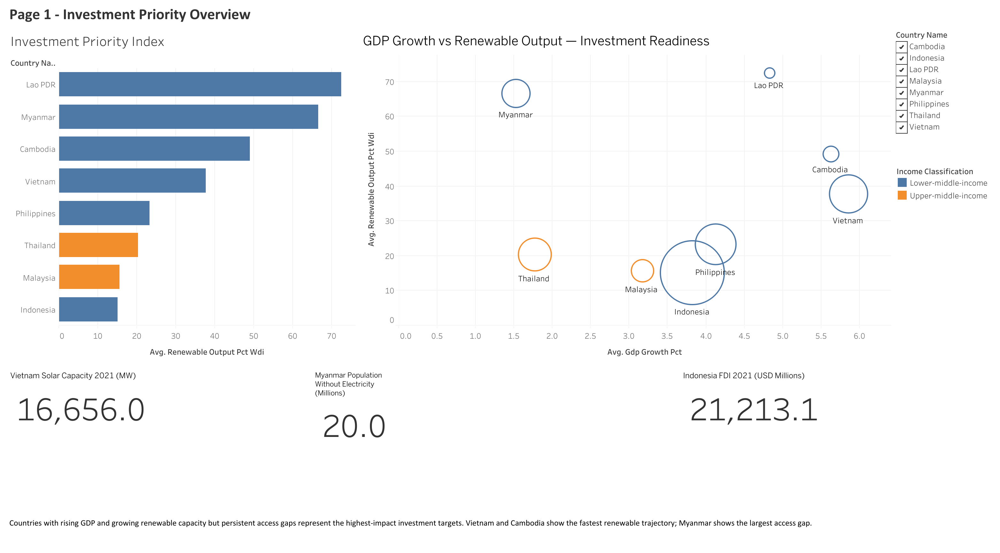
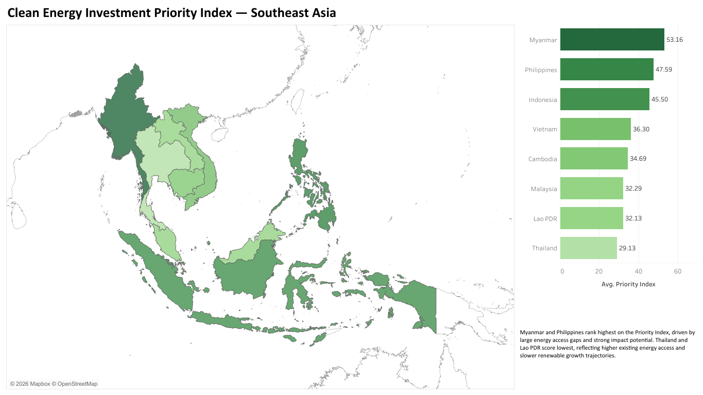
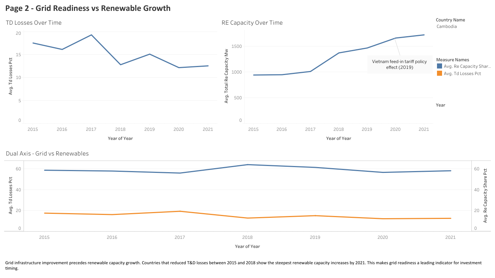
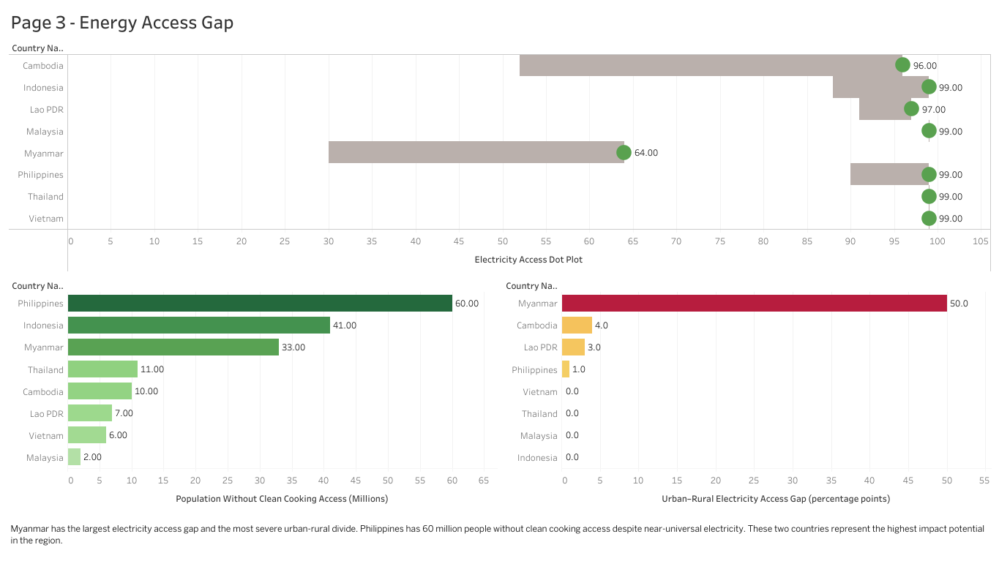

# Clean Energy Investment Priority Index (ASEAN, 2015–2021)

A team data product that ranks eight ASEAN countries for clean energy development
finance. It integrates four data slices into one SQLite model and scores each
country-year on a 0–100 composite index. The intended user is a regional development
finance decision-maker, framed around IFC Asia-Pacific.



## Run it

```bash
python scripts/build_database.py --check      # rebuild DB + index from data/processed/
python scripts/clean_raw_data.py              # optional: re-clean slices whose raw files exist
```

`build_database.py` runs SQL 01 → 02 → 03 → 05 → 04, prints all QC tables, exports
`output/integrated_master_*.csv` and checks them against the committed versions.

## Data model

```
dim_country (8) ──┐
                  ▼
fact_spine (8 countries × 7 years = 56, CROSS JOIN)
   ├─ LEFT JOIN stg_renewable  on country + year   Slice 1: IRENA + World Bank WDI
   ├─ LEFT JOIN stg_grid       on country + year   Slice 3: T&D losses, energy intensity
   ├─ LEFT JOIN stg_economic   on country + year   Slice 4: IMF WEO, FDI, regulatory quality
   └─ LEFT JOIN stg_access     on country only     Slice 2: IEA 2015/2022 snapshots
                  ▼
v_integrated_master (56 × 36) → v_index_normalised → v_priority_index (56 × 40)
```

The year ceiling of 2021 comes from the most restrictive source (energy intensity).

## Index design

| Pillar | Weight | Inputs (sub-weights) |
|---|---:|---|
| Impact Potential | 40% | electricity access gap 40%, clean cooking gap 35%, access improvement speed 25% |
| Market Readiness | 30% | RE output share 30%, grid efficiency (inverted T&D losses) 30%, energy intensity (inverted) 20%, RE capacity 20% |
| Economic Viability | 30% | GDP growth 35%, FDI 30%, regulatory quality 25%, GDP per capita 10% |

Each input is min-max normalised across all 56 rows. Impact gets the most weight because
IFC's mandate puts development impact first.

### 2021 ranking

| Rank | Country | Impact | Readiness | Viability | **Index** |
|---:|---|---:|---:|---:|---:|
| 1 | Philippines | 40.1 | 45.4 | 65.6 | **49.4** |
| 2 | Indonesia | 29.8 | 46.2 | 75.3 | **48.3** |
| 3 | Myanmar | 78.0 | 35.6 | 8.2 | **44.3** |
| 4 | Vietnam | 2.4 | 65.8 | 58.4 | **38.2** |
| 5 | Malaysia | 0.0 | 34.7 | 85.9 | **36.2** |
| 6 | Cambodia | 33.3 | 30.7 | 41.7 | **35.0** |
| 7 | Thailand | 5.4 | 33.6 | 65.8 | **32.0** |
| 8 | Lao PDR | 8.7 | 58.2 | 35.0 | **31.4** |

**Sensitivity.** The Philippines and Indonesia stay in the top two under equal (33/33/33),
readiness-led (25/40/35) and viability-led (25/30/45) weights. Myanmar's position depends
on the impact weight. Averaged over 2015–2021, Myanmar ranks first (53.2), ahead of the
Philippines (47.6) and Indonesia (45.5).

## Quality control

`sql/04_qc_checks.sql` holds 15 checks: row counts, rows per country, NULLs in core
metrics, year range, country count, five known-anomaly checks, approximation flags, slice
coverage and index bounds. `sql/05_priority_index.sql` adds the sensitivity checks. All
pass. Screenshots are in [`docs/qc_results.pdf`](docs/qc_results.pdf).

Known anomalies were kept on purpose. Each was checked against the source:

- Malaysia's flat 6.9% T&D losses
- Lao PDR's drop in T&D losses from 15.7% to 5.4% between 2015 and 2016
- Vietnam's 2019–2020 solar boom
- Myanmar's −12% GDP in 2021
- Thailand's negative FDI in 2020

## Dashboard

Open `dashboard/sdg7_investment_priority.twbx` in Tableau Desktop or Tableau Public. It has four pages:

| Page | Question |
|---|---|
|  | **Overview:** which countries to prioritise? |
|  | **Page 1:** where to invest (GDP growth × RE output, KPI cards) |
|  | **Page 2:** when is the grid ready? (T&D losses vs capacity) |
|  | **Page 3:** where is the impact largest? (access and clean cooking gaps) |

## Files

| Path | Contents |
|---|---|
| `data/processed/clean_slice*.csv` | Cleaned slice outputs, the input to the SQL build |
| `data/processed/integrated_master_from_sql.csv` | 56 × 36 integrated table |
| `data/processed/integrated_master_with_index.csv` | 56 × 40 with index components |
| `docs/data_dictionary.md` | Every column: source, unit, definition, anomalies (`.docx` original alongside) |
| `docs/report.pdf` | Team report |

## Limitations

- Country-level only, with no sub-national analysis.
- No data after 2021.
- No political-risk measure.
- Grid and off-grid electrification are not separated.
- IEA access data has only 2015 and 2022 snapshots, so the Impact pillar does not change from year to year.

*Team project: MSIN0304 Team 3, UCL School of Management, 2025/26.*
