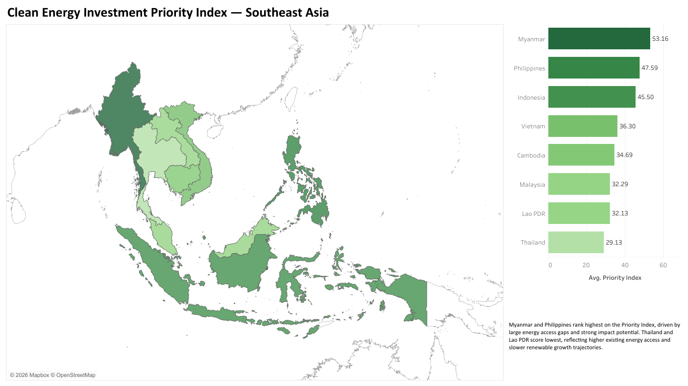

# ASEAN Clean Energy Analytics (SDG 7)

SQL and Python data pipelines that turn public energy and economic statistics into an
investment-prioritisation tool for clean energy in eight Southeast Asian economies.

Built for **MSIN0304 Data Management: Tools and Techniques**, MSc Marketing Science,
UCL School of Management (2025/26).

| | Project | Scope | Output |
|---|---|---|---|
| 1 | [**Renewable Capacity Slice**](01-renewable-capacity-slice/) (individual) | IRENA + World Bank, 8 countries, 2015–2024 | Clean capacity and growth tables, 3 Tableau charts |
| 2 | [**Clean Energy Investment Priority Index**](02-investment-priority-index/) (team) | 4 data slices from IRENA, IEA, World Bank and IMF, 2015–2021 | Integrated SQLite model, 0–100 composite index, 4-page Tableau dashboard |

Project 1 is the renewable-energy slice that feeds Project 2.



## Key findings

- **Vietnam's solar surge.** Renewable capacity rose from 16.7 GW to 48.5 GW (+190%) between 2015 and 2024. Solar PV went from 0.8 MW to 18,662 MW after the 2019 feed-in tariff.
- **Market size is not the driver.** Indonesia, the region's largest economy, grew only 37% over the same period. Policy and grid readiness explain the gap better than GDP.
- **Investment priority (2021).** The Philippines (49.4) and Indonesia (48.3) rank top two. They stay in the top two under all three alternative weighting schemes tested.
- **Myanmar is a sensitivity case.** It has the highest average index across 2015–2021 (53.2) because its access gap is the largest. It falls to third in 2021 and lower when readiness or viability gets more weight.

## Quick start

Requires Python 3.9+. Uses only `sqlite3` from the standard library plus `pandas`.

```bash
git clone https://github.com/<your-username>/asean-sdg7-clean-energy-analytics.git
cd asean-sdg7-clean-energy-analytics
pip install -r requirements.txt

make all        # build both projects and check outputs match the committed data
# or run each one directly:
python 01-renewable-capacity-slice/scripts/run_pipeline.py --check
python 02-investment-priority-index/scripts/build_database.py --check
```

Each script rebuilds its SQLite database in `output/`, prints every validation and QC check,
and with `--check` confirms that the regenerated tables match `data/processed/` exactly.

## Repository layout

```
.
├── 01-renewable-capacity-slice/
│   ├── data/raw/            IRENA and World Bank source files
│   ├── data/processed/      cleaned tables (pipeline output)
│   ├── sql/                 01 schema → 02 cleaning → 03 analysis → 04 bridge joins
│   ├── scripts/             run_pipeline.py (one-command rebuild)
│   ├── docs/                data dictionary, report (PDF)
│   └── figures/             Tableau charts
├── 02-investment-priority-index/
│   ├── data/raw/            raw inputs by slice (Slice 1 included, see data/raw/README.md)
│   ├── data/processed/      cleaned slices + integrated master tables
│   ├── sql/                 01 schema → 02 load → 03 integration → 04 QC → 05 index
│   ├── scripts/             clean_raw_data.py, build_database.py
│   ├── dashboard/           Tableau packaged workbook (.twbx)
│   ├── docs/                data dictionary, QC results, report (PDF)
│   └── figures/             dashboard pages
├── Makefile
└── requirements.txt
```

## Methods

**Data modelling.** Star-style schema with a country dimension and a country × year fact
spine built with a CROSS JOIN. Staging tables are LEFT JOINed onto the spine, so no
observation is dropped silently.

**Data cleaning.** One ISO-3 lookup reconciles naming across sources (for example, Lao PDR
appears as "Lao P.D.R.", "Laos" and "Lao People's Democratic Republic (the)"). Wide World
Bank exports are unpivoted to long format. Missing values follow their source's meaning:
IRENA's `-` (technology not deployed) becomes **0**, World Bank's `..` (not yet reported)
becomes **NULL**. IEA range strings such as `>99%` are converted to numbers and flagged.

**Analytics.** Window functions (`RANK`, `LAG`) and a three-way self-join compute
year-on-year growth and cumulative growth against the 2015 baseline.

**Composite index.** Min-max normalisation, with inverted scales where lower is better.
Three weighted pillars: Impact 40%, Readiness 30%, Viability 30%. Robustness is tested
under equal, readiness-led and viability-led weights, following the OECD composite
indicator handbook (Nardo et al., 2005).

**Quality control.** Row-count, completeness, range and anomaly checks run as SQL
assertions. All checks pass.

**Tools:** SQL (SQLite), Python (pandas), Tableau.

## Data sources

| Provider | Dataset | Used in |
|---|---|---|
| IRENA | Renewable Capacity Statistics / IRENASTAT | 1, 2 |
| World Bank | World Development Indicators, Worldwide Governance Indicators | 1, 2 |
| IEA | Energy Access (electricity, clean cooking) | 2 |
| IMF | World Economic Outlook (GDP growth, GDP per capita) | 2 |

Data belongs to its providers and is included here under their terms for reproducibility.
Check each provider's licence before reusing it.

## Credits

Project 1: Hy Ly. Project 2: MSIN0304 Team 3, UCL School of Management, with Hy Ly
contributing the renewable energy slice. Code is released under the [MIT License](LICENSE).
